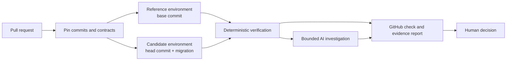

# DataProof

**Catch dangerous database changes before they reach production.**

DataProof is a pull-request review system for PostgreSQL application migrations. For each pull request it runs the proposed migration in a disposable copy of the application, checks data integrity and selected API behavior against protected contracts, investigates failures with evidence-grounded AI, and reports exactly which checks ran, which failed and why, as a GitHub check bound to the commit. Merge and deployment decisions stay with people.

> [!IMPORTANT]
> **Status: early implementation.** The engineering specification is complete. Implemented and tested so far: the typed result contracts ([`packages/contracts`](packages/contracts/README.md)) and the commerce scenario baseline (reference schema, deterministic fixture and candidate migrations), including an integration test in which a migration keeps every row and key while corrupting refund values ([`scenarios/commerce`](scenarios/commerce/README.md)), and the deterministic verifier that evaluates protected oracles against reviewed bindings and shows reviewers exactly what a binding reads ([`packages/verifier`](packages/verifier/README.md)). Across seven commerce change sets, the three clean controls pass with no false positives and the four faults are blocked for the right reasons, including two that aggregate reconciliation cannot see. No end-to-end capability exists yet: every capability and control below is a design commitment until the code and tests for it land. See [How the build proceeds](#how-the-build-proceeds).

## The problem

Many migrations execute successfully while corrupting data. A green migration command, matching row counts and HTTP 200 responses do not show that the business meaning of the data survived.

A concrete case from the demo scenario: a backfill joins refund events to order items before summing them. PostgreSQL executes it without error. The new ledger keeps exactly one row per source event, every key and constraint holds, and row counts match, yet a refund of 49.99 on a two-item order is now recorded as 99.98.

## How it works

1. **Pin the inputs.** Repository, pull request, base and head commits, migration file digests and data-contract revision are fixed before anything runs.
2. **Analyze the change.** Static analysis flags risky SQL, and an advisory AI note suggests edge cases. Neither decides anything.
3. **Provision two environments.** A *reference* (base commit) and a *candidate* (head commit plus migration), each with its own PostgreSQL database, FastAPI backend and Next.js frontend, loaded with the same deterministic fixture. Pull-request code runs only in isolated tasks with no credentials and no network egress.
4. **Verify deterministically.** Schema, row, value, invariant and API comparisons run against protected oracles. Every check is `PASS`, `FAIL`, `ERROR` or `NOT_RUN`.
5. **Investigate failures.** A bounded AI investigator uses five read-only tools and must cite real evidence. It cannot change a verdict.
6. **Reproduce and correct.** DataProof tries to extract a smaller failing fixture and confirm that it replays the same failure. A developer-approved correction is evaluated as a new, separate run.
7. **Report.** A commit-bound GitHub check, a review dashboard with reference and candidate preview URLs, and sealed evidence that outlives the environments.

## Design principles

- **Deterministic code owns every verdict.** AI output is advisory, schema-validated and evidence-cited. It cannot grant permission, mark a check passed, merge or deploy.
- **Never green by omission.** A run that is `NOT_EXECUTED` or `INCOMPLETE` never posts a successful GitHub check.
- **A pull request cannot weaken its own checks.** Expected values come from a protected oracle on the base branch. A pull request may only propose a *binding* that says how to read its new schema, and a person must approve that binding before any check that depends on it can pass.
- **Untrusted by default.** Pull-request code, SQL, comments and AI-visible text are treated as untrusted data. Dependency and runtime changes are not executed until a trusted image is approved.
- **Evidence outlives environments.** Reference and candidate databases are sealed as digest-verified snapshots before cleanup, so diagnosis and reproduction never depend on a destroyed environment.
- **Honest coverage.** Reports show exactly which checks ran. Unsupported or skipped checks are never relabeled as passing.

## Verdicts

| Report verdict | Meaning | GitHub check conclusion |
| --- | --- | --- |
| `BLOCKED` | A required check failed or errored | `failure` |
| `INCOMPLETE` | A required check did not run, including checks awaiting binding review | `action_required` |
| `NOT_EXECUTED` | Policy, path or dependency rules prevented execution | `neutral` |
| `CHECKED` | Every required check passed, with no warnings | `success`, with a coverage table |
| `CHECKED_WITH_WARNINGS` | Every required check passed; optional or advisory checks warned | `success`, with a coverage table |

No verdict is a universal safety guarantee. A run establishes only that specific checks passed for an exact commit, fixture, configuration and engine version.

## Scope

DataProof supports one documented application profile: a **Commerce Orders & Refunds** service built with FastAPI, Next.js, PostgreSQL and Alembic, in which a migration normalizes legacy payment events into a ledger. Hosted execution is limited to allowlisted repositories and images, and pull requests from forks are not executed.

Out of scope: production cutover automation, other databases or warehouses, Spark/dbt/Airflow, multi-cloud deployment, auto-merging, autonomous production repair and general-purpose SQL execution.

## Documentation

| Document | Contents |
| --- | --- |
| [Product](docs/PRODUCT.md) | User, customer journey, committed capabilities, verdict semantics, definition of done |
| [Architecture](docs/ARCHITECTURE.md) | Components, run state machine, data contracts, API surface, AWS target, repository layout |
| [Verification](docs/VERIFICATION.md) | What counts as proof: verification tiers, row matching, contract governance, outcome taxonomy |
| [Scenario contract](docs/SCENARIO_CONTRACT.md) | Demo schemas, invariants C1–C8, safe and faulty migrations, fixture rules |
| [Threat model](docs/THREAT_MODEL.md) | Threat-to-control map, trust boundaries, mandatory security tests |
| [Benchmark](docs/BENCHMARK.md) | Fault families, clean controls, baselines, metrics and protocol |
| [Implementation](docs/IMPLEMENTATION.md) | Repository standards, work packages, gates and pull-request plan |
| [Demo](docs/DEMO.md) | Walkthrough script and the evidence a recorded demo must contain |
| [Architecture decisions](docs/adr/) | ADR-0001 to ADR-0005 |
| [Contracts package](packages/contracts/README.md) | Typed result contracts, their enforced invariants, value encoding and JSON Schemas |
| [Commerce scenario](scenarios/commerce/README.md) | Baseline fixture, its digest and edge cases, and candidate change sets |
| [Verifier](packages/verifier/README.md) | Evaluation order, comparators, outcomes and query safety layers |
| [Sample app](sample-app/README.md) | The application under review: schema and migrations |

To build and test the code, see [CONTRIBUTING.md](CONTRIBUTING.md). Instructions for AI coding assistants are in [AGENTS.md](AGENTS.md).

## How the build proceeds

DataProof is one complete product built in small, reviewed pull requests, each gated by evidence rather than by dates. The work packages, hard gates (G0–G5) and pull-request sequence are in [Implementation](docs/IMPLEMENTATION.md). This README changes only as capabilities are verified: no badges, screenshots, benchmark numbers, live URLs or install commands appear here until they are real.

## Acknowledgements

The review workflow was informed by public descriptions of [Time-Traveler](https://devpost.com/software/time-traveler-w3cxp0) and [Migration Control Tower](https://github.com/Nikhil0075/MIGRATION-CONTROL-TOWER). DataProof is an independent design and implementation and contains no code from either project.

## License

Licensed under the [Apache License, Version 2.0](LICENSE).
