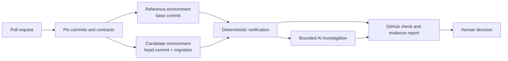

# DataProof

**Catch dangerous database changes before they reach production.**

DataProof is a pull-request review system for PostgreSQL application migrations. For each pull request it does the following:

- runs the proposed migration in a disposable copy of the application;
- checks data integrity and selected API behavior against protected contracts;
- explains failures from cited evidence;
- reports exactly which checks ran, which failed and why, as a GitHub check bound to the commit.

Merge and deployment decisions stay with people.

## Demo

The animation above is a 20-second excerpt from step 2, at real speed. **[Watch the full live run (MP4, 1 min 46 s)](docs/media/live-demo.mp4).** It was recorded by [`scripts/demo/live.py`](scripts/demo/live.py) on a real GitHub pull request, [dataproof-demo-commerce#2](https://github.com/s2002kumar/dataproof-demo-commerce/pull/2), with DataProof running on one machine:

1. Opening the pull request sent GitHub's signed `pull_request` webhook to DataProof. The run migrated isolated copies of the database and built previews of both commits. It is `INCOMPLETE`, and its GitHub check is `action_required`, because the pull request proposes five bindings. The reviewer approves them, which starts one new run.
2. That run is `BLOCKED`, and its check is `failure`: the migration succeeded, but refund event 1002 went from 49.99 to 99.98. Both previews show the order, and the diagnosis cites its evidence.
3. The reviewer replays the corrected commit and approves its bindings.
4. The corrected run is `CHECKED`, and the corrected commit's check is `success`.

Each verdict is a check run on its commit, for anyone to open: [`BLOCKED` on the pull request's head](https://github.com/s2002kumar/dataproof-demo-commerce/runs/126168145938) and [`CHECKED` on the corrected commit](https://github.com/s2002kumar/dataproof-demo-commerce/runs/126170290869).

**What the recording is:**

- **Real:** GitHub (the pull request, the App, its webhook and check runs, and the reviewer's GitHub sign-in) and everything DataProof does.
- **On one machine:** nothing runs in the cloud. The only route reachable from the internet is the webhook intake, through a temporary Cloudflare tunnel.
- **One person:** the pull request's author is also its reviewer, the repository's only maintainer. DataProof allows that only when there is no other maintainer, and records the approvals as procedural rather than organizational separation.
- **The diagnosis** shown is the rule-based, model-off one. The AI investigator is built and tested with scripted models, but no paid model has been called.
- **Timing:** waits for runs happen off camera, each labelled with how long it took. Nothing is sped up. The reviewer signed in before recording, so no credentials are on screen. Between steps the script cancels, off camera, runs it has finished with, so that one machine can hold the live ones.

The same walk-through also runs with no credentials at all, against simulated GitHub: [`scripts/demo/rehearse.py`](scripts/demo/rehearse.py) ([Local rehearsal](docs/DEMO.md#local-rehearsal)).

## Status

| Capability | Implemented and tested | Demonstrated |
| --- | --- | --- |
| GitHub pull request to run | Webhook signatures, pinned runs, App authentication, commit-bound check runs, App registration tooling | Live on GitHub: a real pull request's webhook started the run, and the App published a check run for every run on its commit ([live run](docs/DEMO.md#live-run)) |
| Isolated environments and previews | Local Docker backend with tested isolation, and previews of both commits behind a signed, per-preview gateway | In the live run, and in 15 pipeline-tier runs ([report](benchmarks/results/PIPELINE.md)) |
| Verified migration outcome | Data contracts C1 to C3 and API contracts C6, with reviewed bindings and the approver rule | Live run: `BLOCKED` on the faulty migration, `CHECKED` on the corrected one. Benchmark: 18 of 20 faults at the database tier, all 18 the contracts can observe, with 0 of 11 false positives ([report](benchmarks/results/REPORT.md)). Pipeline tier: 11 of 12 faults and 0 of 3 false positives, end to end. |
| Evidence-grounded diagnosis | Before the migration runs, change analysis: static risk rules on every run, and a bounded AI Change Analyst that may only read the changed source. After the checks, rule-based diagnosis on every failing run, and a bounded AI investigator with five read-only tools. Both AI roles have citation checks and a per-investigation cost cap (a hard limit when the model is pinned), and neither decides anything | Rule-based diagnosis in the live run. The AI evaluation is prepared and its [protocol](docs/AI_EVALUATION.md) fixed: a scripted dry run covers all 18 failing cases, and the rules name the root cause in 9 of them. The static risk rules anticipate 21 of 22 faults but alarm on 6 of 12 clean controls ([report](benchmarks/results/CHANGE_ANALYSIS.md)). Both AI roles' live runs wait for an approved model budget. |
| Reviewer decisions | GitHub sign-in, binding approval and rejection, correction replay, cancellation, and reproduction on a subset | In the live run: GitHub sign-in, binding approval and correction replay |
| Cleanup | Per-run cleanup, plus an independent reaper that works without the control plane | 15 of 15 pipeline-tier runs left nothing behind, and so did the live run. Reaper test |
| Hosted deployment | Not built: a cloud deployment needs an approved cost and security review | — |

## The problem

Many migrations execute successfully while corrupting data. A green migration command, matching row counts and HTTP 200 responses do not show that the business meaning of the data survived.

A concrete case from the demo scenario: a backfill joins refund events to order items before summing them. PostgreSQL executes it without error. The new ledger keeps exactly one row per source event, every key and constraint holds, and row counts match, yet a refund of 49.99 on a two-item order is now recorded as 99.98.

## How it works

1. **Pin the inputs.** Repository, pull request, base and head commits, migration file digests and data-contract revision are fixed before anything runs.
2. **Analyze the change.** Static analysis flags risky SQL, and an advisory AI note suggests edge cases. Neither decides anything.
3. **Provision two environments.** A *reference* (base commit) and a *candidate* (head commit plus migration), each with its own PostgreSQL database, FastAPI backend and Next.js frontend, loaded with the same deterministic fixture. Pull-request code runs only in isolated tasks with no credentials and no network egress.
4. **Verify deterministically.** Schema, row, value, invariant and API comparisons run against protected oracles. Every check is `PASS`, `FAIL`, `ERROR` or `NOT_RUN`.
5. **Investigate failures.** A bounded AI investigator uses five read-only tools and must cite real evidence. It cannot change a verdict.
6. **Reproduce and correct.** DataProof tries to extract a smaller failing fixture and confirm that it replays the same failure. A developer-approved correction is evaluated as a new, separate run.
7. **Report.** A commit-bound GitHub check, a review dashboard with reference and candidate preview URLs, and sealed evidence that outlives the environments.

## Design principles

- **Deterministic code owns every verdict.** AI output is advisory, schema-validated and evidence-cited. It cannot grant permission, mark a check passed, merge or deploy.
- **Never green by omission.** A run that is `NOT_EXECUTED` or `INCOMPLETE` never posts a successful GitHub check.
- **A pull request cannot weaken its own checks.** Expected values come from a protected oracle on the base branch. A pull request may only propose a *binding* that says how to read its new schema, and a person must approve that binding before any check that depends on it can pass.
- **Untrusted by default.** Pull-request code, SQL, comments and AI-visible text are treated as untrusted data. Dependency and runtime changes are not executed until a trusted image is approved.
- **Evidence outlives environments.** Reference and candidate databases are sealed as digest-verified snapshots before cleanup, so diagnosis and reproduction never depend on a destroyed environment.
- **Honest coverage.** Reports show exactly which checks ran. Unsupported or skipped checks are never relabeled as passing.

## Verdicts

| Report verdict | Meaning | GitHub check conclusion |
| --- | --- | --- |
| `BLOCKED` | A required check failed or errored | `failure` |
| `INCOMPLETE` | A required check did not run, including checks awaiting binding review | `action_required` |
| `NOT_EXECUTED` | Policy, path or dependency rules prevented execution | `action_required` |
| `CHECKED` | Every required check passed, with no warnings | `success`, with a coverage table |
| `CHECKED_WITH_WARNINGS` | Every required check passed; optional or advisory checks warned | `success`, with a coverage table |

No verdict is a universal safety guarantee. A run establishes only that specific checks passed for an exact commit, fixture, configuration and engine version.

## Scope

DataProof supports one documented application profile: a **Commerce Orders & Refunds** service built with FastAPI, Next.js, PostgreSQL and Alembic, in which a migration normalizes legacy payment events into a ledger. Hosted execution is limited to allowlisted repositories and images, and pull requests from forks are not executed. Execution is being built on local Docker first; no hosted deployment exists, and a cloud deployment requires an approved cost and security review ([ADR-0006](docs/adr/0006-pluggable-execution-backends.md)).

Out of scope: production cutover automation, other databases or warehouses, Spark/dbt/Airflow, multi-cloud deployment, auto-merging, autonomous production repair and general-purpose SQL execution.

## Documentation

| Document | Contents |
| --- | --- |
| [Product](docs/PRODUCT.md) | User, customer journey, committed capabilities, verdict semantics, definition of done |
| [Architecture](docs/ARCHITECTURE.md) | Components, run state machine, data contracts, API surface, execution backends, proposed AWS target, repository layout |
| [Verification](docs/VERIFICATION.md) | What counts as proof: verification tiers, row matching, contract governance, outcome taxonomy |
| [Scenario contract](docs/SCENARIO_CONTRACT.md) | Demo schemas, invariants C1–C8, safe and faulty migrations, fixture rules |
| [Threat model](docs/THREAT_MODEL.md) | Threat-to-control map, trust boundaries, mandatory security tests |
| [Benchmark](docs/BENCHMARK.md) | Fault families, clean controls, baselines, metrics and protocol |
| [AI evaluation](docs/AI_EVALUATION.md) | The protocol for comparing the AI investigator with the rule-based diagnosis, fixed before any live run |
| [Implementation](docs/IMPLEMENTATION.md) | Repository standards, work packages, gates and pull-request plan |
| [Demo](docs/DEMO.md) | Walkthrough script and the evidence a recorded demo must contain |
| [Architecture decisions](docs/adr/) | ADR-0001 to ADR-0006 |
| [Contracts package](packages/contracts/README.md) | Typed result contracts, their enforced invariants, value encoding and JSON Schemas |
| [Commerce scenario](scenarios/commerce/README.md) | Baseline fixture, its digest and edge cases, and candidate change sets |
| [Verifier](packages/verifier/README.md) | Evaluation order, comparators, outcomes and query safety layers |
| [Control store](packages/control/README.md) | Run state machine, transition log, job queue, leases, fencing, retries and supersession |
| [Investigator](packages/investigator/README.md) | The bounded AI investigator: its loop, five read-only tools, citation rules and model-off baseline |
| [Runner](services/runner/README.md) | Workers, the stage-handler contract, the local Docker backend and its tested isolation |
| [Control plane API](services/api/README.md) | GitHub webhook intake, App authentication, commit-bound check runs, the reviewer API and the signed preview gateway |
| [Dashboard](services/dashboard/README.md) | The reviewer's Next.js view: runs, coverage, checks, the binding inspector, advisory findings, decisions and previews |
| [Benchmark](benchmarks/README.md) | The seeded fault corpus, fair baselines and the generated report |
| [Sample app](sample-app/README.md) | The application under review: schema and migrations |

To build and test the code, see [CONTRIBUTING.md](CONTRIBUTING.md). Instructions for AI coding assistants are in [AGENTS.md](AGENTS.md).

## How the build proceeds

DataProof is one complete product built in small, reviewed pull requests, each gated by evidence rather than by dates. The work packages, hard gates (G0–G5) and pull-request sequence are in [Implementation](docs/IMPLEMENTATION.md). This README changes only as capabilities are verified. The demo recording and the benchmark numbers above come from real runs, and no hosted deployment or live URL exists.

## Acknowledgements

The review workflow was informed by public descriptions of [Time-Traveler](https://devpost.com/software/time-traveler-w3cxp0) and [Migration Control Tower](https://github.com/Nikhil0075/MIGRATION-CONTROL-TOWER). DataProof is an independent design and implementation and contains no code from either project.

## License

Licensed under the [Apache License, Version 2.0](LICENSE).
