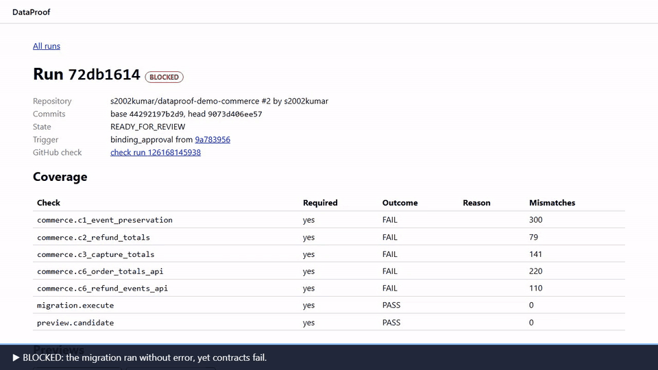
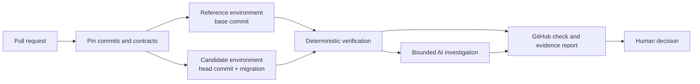

# DataProof

**A migration can run without a single error and still corrupt your data. DataProof catches that on the pull request.**

DataProof runs a PostgreSQL/Alembic migration in disposable reference and candidate databases, compares the data against contracts the pull request cannot edit, and reports a GitHub check bound to the commit: `BLOCKED` with the exact rows that changed, or `CHECKED` with the exact list of what was verified. Merge and deployment decisions stay with people.

**Demonstrated scope:** one documented application profile (Commerce Orders & Refunds) on local Docker, with a real GitHub App integration; not a hosted, general-purpose migration service. The recorded diagnosis is deterministic and rule-based; the bounded AI roles are tested with scripted models, and whether a live model improves on the rules is not yet established. Everything else that bounds the claims is in [Limitations](#limitations).

## The failure it catches

This migration moves legacy payment events into a per-order ledger. It joins the events to the order's items before summing, so an order with two items counts each event twice:

```sql
INSERT INTO ledger_entries (order_id, ledger_sequence, source_event_id, entry_kind, amount, occurred_at)
SELECT e.order_id,
       ROW_NUMBER() OVER (PARTITION BY e.order_id ORDER BY e.occurred_at, e.event_id),
       e.event_id, e.event_kind, SUM(e.amount), e.occurred_at
FROM legacy_payment_events AS e
JOIN order_items AS oi ON oi.order_id = e.order_id
GROUP BY e.event_id, e.order_id, e.event_kind, e.occurred_at
```

PostgreSQL executes it without error. The ledger has exactly one row per source event, every key and constraint holds, and row counts match. Yet refund event 1002, a refund of **49.99** on a two-item order, is now recorded as **99.98**.

DataProof ran this migration on a real pull request, [dataproof-demo-commerce#2](https://github.com/s2002kumar/dataproof-demo-commerce/pull/2), and left two check runs that anyone can open:

| Commit | DataProof's verdict | GitHub check |
| --- | --- | --- |
| The pull request's head (the migration above) | `BLOCKED`: contract C1 failed, refund 1002 expected `49.99`, observed `99.98` | [`failure`](https://github.com/s2002kumar/dataproof-demo-commerce/runs/126168145938) |
| The corrected commit (a direct copy, one ledger row per event) | `CHECKED`: every required check passed | [`success`](https://github.com/s2002kumar/dataproof-demo-commerce/runs/126170290869) |

[](docs/media/live-demo.mp4)

The animation is a 20-second excerpt of the live run at real speed; the [full recording (MP4, 1 min 46 s)](docs/media/live-demo.mp4) shows the pull request opening, the binding approval, the `BLOCKED` run, the correction replay and the `CHECKED` run. What is real, what ran on one machine, and what the recording does not show are stated in [Limitations](#limitations).

## Measured

On a seeded corpus of 20 faulty and 11 clean migrations of the same schema ([report](benchmarks/results/REPORT.md)):

| Method | Faults detected | False positives on clean migrations |
| --- | --- | --- |
| Migration ran without error (`B0`) | 0 of 20 | 0 of 11 |
| Row counts, key hashes and refund/capture sums (`B1`) | 13 of 20 | 0 of 11 |
| DataProof's data contracts (`B2`) | **18 of 20** | **0 of 11** |

The two misses are faults no declared contract observes (NULL and empty-string confusion), and they are reported as misses, not excluded. End to end on the real worker with previews of both commits, 11 of 12 faults were blocked and 0 of 3 clean migrations flagged, with a median of 158 seconds from pull request to review and nothing left behind in any run ([pipeline report](benchmarks/results/PIPELINE.md)). A test regenerates both reports and fails if the committed results drift. The corpus was written by DataProof's author, which limits what these numbers show; see [Limitations](#limitations).

## How it works

1. **Pin the inputs.** Repository, pull request, base and head commits, migration digests and contract revision are fixed before anything runs.
2. **Analyze the change.** Static rules flag risky SQL before the migration runs; an advisory AI note may suggest edge cases. Neither decides anything.
3. **Provision two environments.** A *reference* (base commit) and a *candidate* (head commit plus migration), each with its own PostgreSQL database, API and frontend, loaded with the same deterministic fixture. Pull-request code runs only in isolated containers with no credentials and no network egress.
4. **Verify deterministically.** Keyed comparisons of exact decimals, instants, kinds and references run against *protected oracles* read from the base branch. A pull request may only propose a *binding* that says how to read its new schema, and a person must approve that binding before any check that depends on it can pass. Every check is `PASS`, `FAIL`, `ERROR` or `NOT_RUN`.
5. **Explain failures.** A rule-based diagnosis runs on every failing check. A bounded AI investigator with five read-only tools may add hypotheses, each of which must cite real evidence. It cannot change a verdict.
6. **Reproduce and correct.** DataProof extracts a smaller failing subset and confirms it replays the same failure. A corrected commit is evaluated as a new, separate run.
7. **Report.** A commit-bound GitHub check with the coverage table, a review dashboard with reference and candidate preview URLs, and sealed evidence that outlives the environments.



| Report verdict | Meaning | GitHub check conclusion |
| --- | --- | --- |
| `BLOCKED` | A required check failed or errored | `failure` |
| `INCOMPLETE` | A required check did not run, including checks awaiting binding review | `action_required` |
| `NOT_EXECUTED` | Policy, path or dependency rules prevented execution | `action_required` |
| `CHECKED` | Every required check passed, with no warnings | `success`, with a coverage table |
| `CHECKED_WITH_WARNINGS` | Every required check passed; optional or advisory checks warned | `success`, with a coverage table |

A run that is `NOT_EXECUTED` or `INCOMPLETE` never posts a green check, and unsupported or skipped checks are never relabeled as passing.

## Try it

DataProof is a GitHub App with its own control plane, dashboard and worker. It runs today on one machine with Docker; there is no hosted service. The whole review above, with no credentials and against a simulated GitHub, is one command:

```sh
uv run python scripts/demo/rehearse.py --image <runtime image ID>
```

[Local rehearsal](docs/DEMO.md#local-rehearsal) explains the prerequisites and what the rehearsal shows; [Live setup](docs/DEMO.md#live-setup) explains how the live run on real GitHub was made, for an owner who registers their own App.

The database tier alone is also a **GitHub Action** ([docs/ACTION.md](docs/ACTION.md)): the same verifier, backend and report, inside a repository's own CI, with the pull request's migration isolated from the job's token and secrets and the contracts read from the base branch. It is built, covered by adversarial tests, runs on this repository's own pull requests, and has a public example repository, [dataproof-example-subscriptions](https://github.com/s2002kumar/dataproof-example-subscriptions), whose pull requests are genuine runs on a second, independently designed schema. It has also run on [a fork](https://github.com/s2002kumar/dataproof-field-fastapi-template) of `fastapi/full-stack-fastapi-template`, an application its author did not write: the template's own UUID-key migration was `CHECKED` and a corrupted copy `BLOCKED` ([field results](docs/ACTION_FIELD_RESULTS.md#an-application-dataproofs-author-did-not-write)). It has **no version tag yet**: a tag needs the gates in [RELEASE.md](docs/RELEASE.md), including the release security review ([ACTION_SECURITY_REVIEW.md](docs/ACTION_SECURITY_REVIEW.md)), and the owner's approval. Nobody but the author has run it, so no adoption is claimed ([#80](https://github.com/s2002kumar/DataProof/issues/80)).

## Status

| Capability | Implemented and tested | Demonstrated |
| --- | --- | --- |
| GitHub pull request to run | Webhook signatures, pinned runs, App authentication, commit-bound check runs, App registration tooling | Live on GitHub: a real pull request's webhook started the run, and the App published a check run for every run on its commit ([live run](docs/DEMO.md#live-run)) |
| Isolated environments and previews | Local Docker backend with tested isolation, and previews of both commits behind a signed, per-preview gateway | In the live run, and in 15 pipeline-tier runs ([report](benchmarks/results/PIPELINE.md)) |
| Verified migration outcome | Data contracts C1 to C3 and API contracts C6, with reviewed bindings and the approver rule | Live run: `BLOCKED` on the faulty migration, `CHECKED` on the corrected one. Benchmark: 18 of 20 faults at the database tier, 0 of 11 false positives ([report](benchmarks/results/REPORT.md)); 11 of 12 and 0 of 3 end to end |
| Evidence-grounded diagnosis | Before the migration runs, change analysis: static risk rules on every run, and a bounded AI Change Analyst that may only read the changed source. After the checks, rule-based diagnosis on every failing run, and a bounded AI investigator with five read-only tools. Both AI roles have citation checks and a per-investigation cost cap, and neither decides anything | Rule-based diagnosis in the live run. The AI evaluation [protocol](docs/AI_EVALUATION.md) is frozen and dry-run on all 18 failing cases; the rules name the root cause in 9 of them. The static risk rules anticipate 21 of 22 faults but alarm on 6 of 12 clean controls ([report](benchmarks/results/CHANGE_ANALYSIS.md)). The live model runs have an approved budget and are next |
| Reviewer decisions | GitHub sign-in, binding approval and rejection, correction replay, cancellation, and reproduction on a subset | In the live run: GitHub sign-in, binding approval and correction replay |
| Cleanup | Per-run cleanup, plus an independent reaper that works without the control plane | 15 of 15 pipeline-tier runs and the live run left nothing behind; reaper test |
| GitHub Action (database tier) | Repository-owned configuration, oracles, fixture and approvals from the base branch; the migration isolated in a container; job summary, annotations and a JSON report; adversarial tests ([ADR-0007](docs/adr/0007-github-action-database-tier.md)) | On a second, independently designed schema, on a public example repository with real GitHub Actions results: the correct cents-to-money migration [`INCOMPLETE` until its binding was approved on `main`, then `CHECKED`](https://github.com/s2002kumar/dataproof-example-subscriptions/pull/1); integer division [`BLOCKED` with the exact amounts](https://github.com/s2002kumar/dataproof-example-subscriptions/pull/2) (19.99 observed as 19.00 on invoice 5003, 396 mismatches). 40 s from opening a pull request to its verdict ([field results](docs/ACTION_FIELD_RESULTS.md)). On a fork of `fastapi/full-stack-fastapi-template`, written by others: its UUID-key migration `CHECKED`, a corrupted copy `BLOCKED` with 8 mismatches, 37 s each. Not yet run by anyone else |
| Hosted deployment | Not built: a cloud deployment needs an approved cost and security review | — |

[Status](docs/STATUS.md) compares every product requirement with what has been verified, with the evidence and every shortfall.

## Limitations

Everything DataProof claims is bounded by the following. None of it is hidden elsewhere.

**What a verdict means.** A run establishes only that specific checks passed for an exact commit, fixture, configuration and engine version. No verdict is a universal safety guarantee. Snapshots do not prove production-scale locking, traffic race conditions, isolation edge cases, performance or untested application paths ([Verification](docs/VERIFICATION.md#honest-limits)).

**What is checked.** The protected contracts are C1 (every event preserved: order, kind, exact amount, exact instant), C2 (refund totals per order and currency), C3 (capture totals) and C6 (selected API responses). Of the specification's other invariants, C8 is built as a type check (every compared column's declared type can hold its comparator: scale for money, a time zone for an instant), C7 as a rerun check in the Action (a second upgrade must change nothing), and C4 and C5 are established through C1's keyed comparison of references and instants; none is a constraint audit, a relational-invariant language or a timestamp policy, and the claims are narrowed to exactly that in [ADR-0008](docs/adr/0008-invariants-c4-to-c8.md). No schema-diff tool has been run. NULL and empty-string confusion is invisible to the declared contracts, which is why 2 of the 20 benchmark faults are missed.

**The benchmark.** The corpus is generated from templates with a frozen seed by the author of the system under test. It is not independently authored, and no third party has verified any result. The static risk rules' recall is optimistic for the same reason: they were written with the corpus in view. The AI investigator and Change Analyst have been run only with scripted models so far; their live evaluation is prepared and budgeted, not done.

**The live recording.** Real: GitHub (the pull request, the App, its webhook and check runs, the reviewer's sign-in) and everything DataProof does. On one machine: nothing runs in the cloud; the only route reachable from the internet was the webhook intake, through a temporary Cloudflare tunnel. One person: the pull request's author was also its reviewer and the repository's only maintainer, which DataProof allows only when there is no other maintainer, and the approvals are recorded as procedural rather than organizational separation. The diagnosis shown is the rule-based, model-off one. Waits for runs happen off camera and are labelled with how long they took; nothing is sped up. The dashboard has since been reorganized ([run page](services/dashboard/README.md#pages)); the recording shows the earlier one. After the recording, a publisher bug was found that could leave a superseded run's check run as the one GitHub reads on a commit; GitHub's rule was probed on the demo repository and the publisher fixed with regression tests against a simulated GitHub, but **the fixed publisher has not yet been run against real GitHub** ([check-run finality](docs/DEMO.md#check-run-finality)).

**Scope.** One supported application profile: a Commerce Orders & Refunds service built with FastAPI, Next.js, PostgreSQL and Alembic ([Scenario contract](docs/SCENARIO_CONTRACT.md)). Execution is local Docker, a trusted-development backend that shares the host kernel ([ADR-0006](docs/adr/0006-pluggable-execution-backends.md)); no hosted deployment exists, and a cloud deployment requires an approved cost and security review. Pull requests from forks are not executed. Out of scope: production cutover automation, other databases or warehouses, Spark/dbt/Airflow, multi-cloud deployment, auto-merging, autonomous production repair and general-purpose SQL execution.

**One check per commit.** Check runs belong to a commit, so two pull requests with the same head commit share one latest `DataProof` check.

## Design principles

- **Deterministic code owns every verdict.** AI output is advisory, schema-validated and evidence-cited. It cannot grant permission, mark a check passed, merge or deploy.
- **Never green by omission.** A run that is `NOT_EXECUTED` or `INCOMPLETE` never posts a successful GitHub check.
- **A pull request cannot weaken its own checks.** Expected values come from a protected oracle on the base branch. A pull request may only propose a *binding*, and a person must approve it before any check that depends on it can pass ([ADR-0005](docs/adr/0005-oracle-binding-governance.md)).
- **Untrusted by default.** Pull-request code, SQL, comments and AI-visible text are treated as untrusted data. Dependency and runtime changes are not executed until a trusted image is approved.
- **Evidence outlives environments.** Reference and candidate databases are sealed as digest-verified snapshots before cleanup, so diagnosis and reproduction never depend on a destroyed environment.
- **Honest coverage.** Reports show exactly which checks ran. Unsupported or skipped checks are never relabeled as passing.

## Documentation

| Document | Contents |
| --- | --- |
| [Product](docs/PRODUCT.md) | User, customer journey, committed capabilities, verdict semantics, definition of done |
| [Architecture](docs/ARCHITECTURE.md) | Components, run state machine, data contracts, API surface, execution backends, proposed AWS target, repository layout |
| [Verification](docs/VERIFICATION.md) | What counts as proof: verification tiers, row matching, contract governance, outcome taxonomy |
| [Scenario contract](docs/SCENARIO_CONTRACT.md) | Demo schemas, invariants C1–C8, safe and faulty migrations, fixture rules |
| [Threat model](docs/THREAT_MODEL.md) | Threat-to-control map, trust boundaries, mandatory security tests |
| [Benchmark](docs/BENCHMARK.md) | Fault families, clean controls, baselines, metrics and protocol |
| [Status](docs/STATUS.md) | The product requirements against what has been verified, with the evidence and every shortfall |
| [Release](docs/RELEASE.md) and [changelog](CHANGELOG.md) | The gates for 1.0.0, the open issues classified, the known limitations; what changed for a user |
| [AI evaluation](docs/AI_EVALUATION.md) | The protocol for comparing the AI investigator with the rule-based diagnosis, fixed before any live run |
| [Implementation](docs/IMPLEMENTATION.md) | Repository standards, work packages, gates and pull-request plan |
| [Demo](docs/DEMO.md) | Walkthrough script, live setup, the live run's evidence and the local rehearsal |
| [Narrated demonstration](docs/DEMO_NARRATION.md) | A six-minute script in four acts: the failure, the protected oracle, the approval, the verdicts; with what not to claim |
| [Defense](docs/DEFENSE.md) | Architecture in review order, the difficult bugs, alternatives rejected, other tools, security limitations and benchmark weaknesses |
| [GitHub Action](docs/ACTION.md) | Quickstart, configuration reference, the isolation guarantee and its limits, field results, and what stays with the App |
| [Architecture decisions](docs/adr/) | ADR-0001 to ADR-0008 |
| [Report package](packages/report/README.md) | The report as Markdown: the App's check summaries and the Action's job summaries, from trusted results only |
| [Subscriptions example](examples/subscriptions/README.md) | A second application profile, designed independently of commerce, as a repository that uses the Action |
| [Contracts package](packages/contracts/README.md) | Typed result contracts, their enforced invariants, value encoding and JSON Schemas |
| [Commerce scenario](scenarios/commerce/README.md) | Baseline fixture, its digest and edge cases, and candidate change sets |
| [Verifier](packages/verifier/README.md) | Evaluation order, comparators, outcomes and query safety layers |
| [Control store](packages/control/README.md) | Run state machine, transition log, job queue, leases, fencing, retries and supersession |
| [Investigator](packages/investigator/README.md) | The bounded AI investigator: its loop, five read-only tools, citation rules and model-off baseline |
| [Runner](services/runner/README.md) | Workers, the stage-handler contract, the local Docker backend and its tested isolation |
| [Control plane API](services/api/README.md) | GitHub webhook intake, App authentication, commit-bound check runs, the reviewer API and the signed preview gateway |
| [Dashboard](services/dashboard/README.md) | The reviewer's Next.js view: runs, coverage, checks, the binding inspector, advisory findings, decisions and previews |
| [Benchmark](benchmarks/README.md) | The seeded fault corpus, fair baselines and the generated report |
| [Sample app](sample-app/README.md) | The application under review: schema and migrations |

To build and test the code, see [CONTRIBUTING.md](CONTRIBUTING.md). Instructions for AI coding assistants are in [AGENTS.md](AGENTS.md). DataProof is built in small, reviewed pull requests gated by evidence; the work packages and gates are in [Implementation](docs/IMPLEMENTATION.md), and this README changes only as capabilities are verified.

## Acknowledgements

The review workflow was informed by public descriptions of [Time-Traveler](https://devpost.com/software/time-traveler-w3cxp0) and [Migration Control Tower](https://github.com/Nikhil0075/MIGRATION-CONTROL-TOWER). DataProof is an independent design and implementation and contains no code from either project.

## License

Licensed under the [Apache License, Version 2.0](LICENSE).
