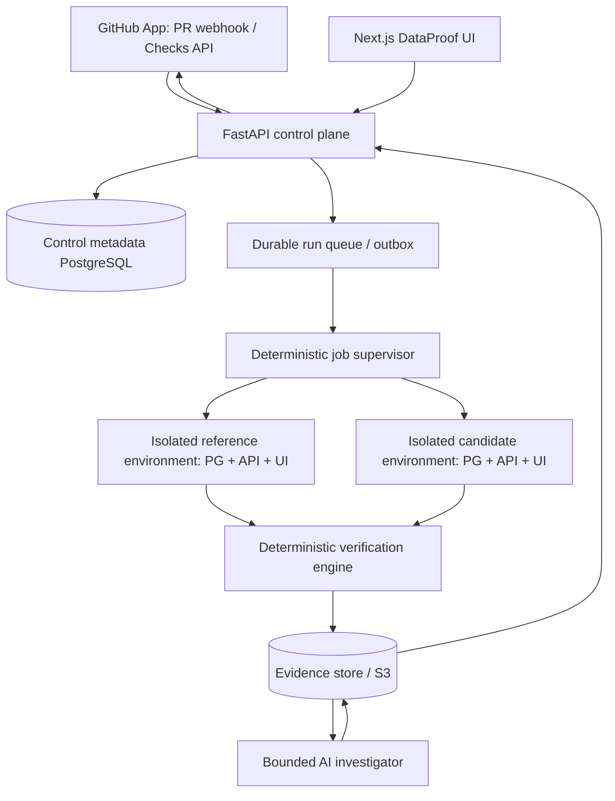

# ARCHITECTURE — Components, Control Flow and Contracts

## Principle

DataProof pairs a developer-facing **review workflow** (developer change → multi-stage analysis → live shadow preview → API/database checks → review) with strict **control discipline** (deterministic state and authorization). Deep data integrity and evidence-grounded diagnosis are its focus. No AI may grant permission, apply production SQL, merge or manufacture a pass result.

## Runtime architecture



The supervisor creates reference and candidate environments through an execution-backend interface (ADR-0006). Local Docker is the first backend; the AWS Fargate backend described below is a proposed hosted target that is not provisioned and requires owner approval.

## Service responsibilities

1. **GitHub connector:** verify webhook signature, installation and repo allowlist; pin PR base and head SHA; enumerate changed paths without trusting PR prose; create/update a check run bound to head SHA. GitHub Checks write operations require a GitHub App: <https://docs.github.com/en/rest/checks/runs>
2. **API/control plane (FastAPI/Pydantic):** enforce authorization and quotas, create idempotent runs, store immutable input manifest, expose read-only review APIs, record human approval independently.
3. **Durable supervisor/queue:** PostgreSQL-backed job table/outbox with `SELECT ... FOR UPDATE SKIP LOCKED`, persisted leases and heartbeat, retry budget and idempotent fencing. Schedule jobs, cancel on superseding head SHA, enforce TTL/concurrency. No Redis/SQS; the LLM has no transition authority. The execution supervisor (and independent expiry reconciler) are trusted services, not code in the PR task. Implemented in [`packages/control`](../packages/control/README.md) (store, queue and lifecycle) and [`services/runner`](../services/runner/README.md) (workers).
4. **Shadow runner:** provision **two distinct** disposable application environments (reference and candidate), each with PostgreSQL sidecar, app API and frontend. The reference uses base SHA; candidate uses head SHA and approved Alembic migrations; both load an identical versioned baseline. Runtime and dependencies are pinned by approved image digest. The trusted ingestion service fetches the exact SHA archive and exposes only a digest-verified source artifact to tasks; candidate tasks get no GitHub token or cloud credentials. Candidate source executes only inside resource-limited isolated compute; `Dockerfile`, dependency manifests/lockfile or paths outside `allowed_change_roots` trigger `NOT_EXECUTED: DEPENDENCY_CHANGE_REQUIRES_IMAGE_APPROVAL`. For Next.js, a pinned offline `next build` happens **inside the restricted task** before `next start` (simply mounting changed source and running `next start` on prebuilt output would not reflect frontend changes), under the offline-build constraints in ADR-0004. No user-controlled Docker builds. Local Docker is operated only by trusted supervisor; see ADR-0004 and THREAT_MODEL.
5. **Verification engine:** run static/schema checks, migration execution asserts, typed `oracle` expectations calculated only from base reference data and reviewed `candidate_binding` queries/mappings, plus before/after API tests; emit `PASS/FAIL/ERROR/NOT_RUN`, exact evidence and timings. Checks that depend on a new or changed candidate binding without a digest-bound approval are `NOT_RUN: AWAITING_BINDING_REVIEW`, so the run's verdict is `INCOMPLETE`; approval starts a new run (see Run state machine). Non-equivalence invariants must first pass on reference; otherwise `ERROR: ORACLE_VIOLATED_ON_REFERENCE` (a fixture/contract defect, not PR corruption).
6. **AI investigator:** an advisory Change Analyst before execution and a Failure Investigator after checks, using deterministic evidence and tool-calling. The correction adviser is an optional mode of the same investigator. No privilege escalation or autonomous fixes.
7. **Evidence store:** content-addressed dataset hashes; **sealed `pg_dump -Fc` reference and candidate snapshots** captured before cleanup, subject to fixture-only data policy, retention and storage limits; SHA-256 snapshot and source/config digests; redacted logs, findings, samples, query results, API comparisons, diagnostics and cleanup records. `INVESTIGATING` may use live read-only databases before cleanup; later `/diagnose` and `/reproduce` restore verified snapshot artifacts into a fresh isolated runner. Store manifest + metadata transactionally and seal object artifacts before reporting completion.
8. **Review UI:** secure expiring preview URLs; side-by-side reference/candidate application behavior; run timeline; invariant report; AI evidence citations; reproducibility and correction replay; coverage and developer decision.

## Run state machine

`QUEUED -> FETCHING -> ANALYZING -> PROVISIONING -> MIGRATING -> VERIFYING -> (INVESTIGATING -> REPRODUCING?) -> REPORTING -> READY_FOR_REVIEW -> CLEANING -> COMPLETE`

**Binding review is not a run state, and no run waits for a human.** When the head commit introduces or changes a candidate binding that has no digest-bound approval, the run proceeds normally: in `VERIFYING` every binding-dependent check is recorded `NOT_RUN: AWAITING_BINDING_REVIEW`, the run continues through `REPORTING -> READY_FOR_REVIEW -> CLEANING -> COMPLETE` with report verdict `INCOMPLETE` (GitHub `action_required`), and its environments are torn down on the normal TTL. A later `APPROVE_BINDING` never resumes or alters that run. It enqueues a **new run** for the same base/head SHAs and baseline digest, with a new config digest that includes the approved binding digest, and the new run re-provisions both environments deterministically. The original run, its `INCOMPLETE` report and its evidence stay unchanged. This keeps task TTL (hours) independent of human review latency (days). `AWAITING_BINDING_REVIEW` exists only as a per-check `NOT_RUN` reason and as a cause of the `INCOMPLETE` verdict.

A new head SHA supersedes any previous attempt via terminal `SUPERSEDED` (never green). `NOT_EXECUTED` is an explicit terminal outcome for unsupported/blocked source or dependency changes.

At any stage, a typed `ERROR`/`CANCELLED`/`TIMED_OUT` may lead to `CLEANING`; **cleanup never rewrites verification outcomes**. States `INCOMPLETE` and `BLOCKED` are derived report verdicts, not substitutes for executable run-state transitions. All transitions validated by code, and by the control database, whose transition log can record only transitions in the same table ([`packages/control`](../packages/control/README.md)). A superseded run that is still working or in review is cancelled, cleaned up and ends `SUPERSEDED`. Idempotency key = (repo, PR, baseSHA, headSHA, configDigest, datasetDigest, engineVersion). Because an approved binding changes the config digest, the run it starts never collides with the original run's key.

## Data contracts (provisional JSON-schema-level shapes)

Implemented in [`packages/contracts`](../packages/contracts/README.md) as Pydantic models with exported JSON Schemas; that README lists the invariants each model enforces.

- `ProjectConfig`: `project_id`, allowlisted repo, `runtime_image_digest`, `allowed_change_roots`, migration roots, exact base/head SHA, baseline digest, approved dependency lock digests, API fixtures, oracle refs, candidate binding refs, quotas and preview policy. Validated `dataproof.yml` is pinned to the trusted configuration; unapproved head changes never gain execution authority.
- `ReviewRun`: UUID, `input_digest`, PR and SHAs, timestamps, current state, worker lease, isolation ID, status and error code, plus `trigger` (`webhook`, `manual`, `binding_approval`, `correction_replay`) and `parent_run_id` for a run started by a decision on an earlier run.
- `MigrationStep`: step ID, path, SQL digest, ordering, execution result, affected schema and source line ranges.
- `DataContract`: ID/version, **protected `oracle`** (reference-only expected values, complete expected keys and comparator policy), separately **PR-proposed `candidate_binding`** (target table/query/API field mapping), semantic key(s), exact typed comparator, precision/tolerance, requiredness, severity and binding review decision/digest. A candidate binding cannot edit oracle scope, thresholds or requiredness; changed binding is untrusted until approved (ADR-0005).
- `CheckResult`: result state, contract version, observed counts/keys/mismatches, evidence refs, executed dataset digest, elapsed time and reason for `NOT_RUN`.
- `Finding`: severity, type, affected objects, example records (redacted), evidence IDs, source reference and deterministic check reference.
- `Investigation`: model+prompt/tool versions, hypotheses, called tool name/args, cited evidence IDs, confidence caveat, suggested action, token/cost/latency.
- `Reproduction`: original check/failure signature, fixture record IDs + dependencies, fixture digest, separate replay run and verified persistence of the same failure.
- `HumanDecision`: actor, commit/run ID, timestamp, comment, review action; for `APPROVE_BINDING`, the binding digest and whether approver/author separation was organizational or procedural (single-maintainer repository). Not a modification of check outcomes.
- `EvidenceManifest`: reference/candidate `pg_dump -Fc` artifacts and SHA-256, dataset/source/config/binding digests, verified restore manifest, retention/expiry, image digests, evidence records and cleanup log.

**Contract trust:** Protected base-SHA **oracles** alone determine expected results. A schema-changing PR supplies only a candidate read mapping; its binding undergoes a separate, auditable `APPROVE_BINDING` human decision, and only the new run started under the resulting config digest can evaluate binding-dependent checks. The reviewer cannot weaken the oracle by approving a binding. See ADR-0005 and `SCENARIO_CONTRACT.md`.

## API surface

- `POST /projects/{id}/runs` (authorized trigger, exact commit SHA) → `{run_id, status}`; idempotent on input manifest.
- `GET /runs/{id}` → state, report, summary, coverage, preview URLs if authorized.
- `GET /runs/{id}/checks` and `GET /runs/{id}/findings` → typed results with pagination and redaction.
- `GET /runs/{id}/evidence` → signed authenticated artifact access; limited TTL.
- `POST /runs/{id}/diagnose` → bounded investigator replay: restore verified reference/candidate `pg_dump -Fc` artifacts into a fresh credential-less isolated runner; uses read-only diagnostic tools, not a database destroyed by cleanup.
- `POST /runs/{id}/reproduce` → authorized FK-closure subset extraction from the sealed **baseline reference**, fresh reproduction run and same contract digest; returns `REPRODUCED` or `NOT_REPRODUCED` with evidence.
- `POST /runs/{id}/correction-replay` → developer-supplied reviewed candidate ref; a **new run** with new config/source digests, no mutation of original.
- `POST /runs/{id}/binding-decisions` → authorized `APPROVE_BINDING` or `REJECT_BINDING`, bound to proposed mapping digest, reviewer identity and head SHA. An approval enqueues a new run (`trigger=binding_approval`); it never resumes the original run, edits the oracle or changes existing results.
- `POST /github/webhook` → validated signed event, idempotent webhook intake.
- `POST /runs/{id}/cancel` → authorized cancellation and cleanup.

The listed endpoints specify desired behavior, not implemented routes. OpenAPI schemas are generated and contract-tested once coding begins.

## Shadow preview and behavior comparison

- *Reference* = trusted base-commit app & schema with baseline fixture. *Candidate* = PR head app & schema after actual migration of equivalent baseline. Never compare a public demo to live production.
- Both previews expose selected safe routes through a **trusted authenticated gateway** with expiring run-scoped tokens. The gateway forwards only to private task addresses registered by the trusted supervisor and verifies task ownership/TTL (never accepts arbitrary URL/IP supplied by a client). API behavior is compared via reviewed endpoint/field bindings on stable semantics; IDs, dates and sorting require explicit canonicalization.
- A reference and candidate may have different internal schemas; equivalent **business outputs** are required only if declared. Unknown means not checked, not fail by default.
- Preview frontend is primarily to make the product easy to demo, not a generalized app-cloning platform. A supported profile contract and manifest govern what can be run.

## Execution backends

- **Interface:** provision a role-scoped environment from a digest-pinned image, deliver a digest-verified source artifact, run a bounded step, expose the database to trusted services only, list resources by run, destroy, and report observed resource use. Run state, leases, retries, verification, evidence and reporting are backend-independent (ADR-0006).
- **Local Docker (first backend):** per run and role, a separate internal network with no route to the internet, the host or the other role; digest-pinned images; all capabilities dropped, `no-new-privileges`, non-root users, memory/CPU/PID limits; run-scoped labels for cleanup and expiry reconciliation; no GitHub, cloud or model credentials; PostgreSQL reachable by trusted services only through a loopback-bound port. A trusted-development boundary (shared kernel, operator daemon trusted), not a public hosting boundary.
- **Cloud backends:** none provisioned. Before any cloud deployment, a measured cost estimate, the security implications and the lowest-cost viable hosting options are presented for owner approval (ADR-0006).

## Proposed AWS deployment target (approval-gated)

Not provisioned. This section is the design requirement for a hosted backend if one is approved under ADR-0006.

- Control plane API/web behind authenticated HTTPS; metadata PostgreSQL in appropriately managed/staged service; immutable evidence S3 with restricted IAM, CloudWatch observability.
- **Two isolated ECS/Fargate tasks per run** (one reference, one candidate), each with an application process/frontend and PostgreSQL sidecar in a reviewed immutable runtime/dependency image. Candidate source is a digest-verified overlay executed/compiled in the task without `docker build`, arbitrary dependency install or internet fetch. No `taskRoleArn` for the untrusted task; separate tightly scoped Fargate **execution role** only for image pulls/log delivery, never mounted into app code. No NAT route; private, scoped VPC endpoints for approved infrastructure operations; ECS Exec disabled. A trusted broker stages source (delivered to the task as a pre-signed, VPC-endpoint-bound GET that a trusted entrypoint verifies by SHA-256) and captures sealed `pg_dump` artifacts over the private network; no runner AWS/GitHub/model key. Security groups admit port 5432 on a run task only from the supervisor, verifier and broker. Independent EventBridge expiry reconciler terminates orphans if the API is down. See ADR-0004.
- Public demo: allowlisted repo/branches and pinned runtime/dependency digests; **fork PRs not executed**; unexpected Dockerfile/lockfile/build-file changes not executed. Fixed hard concurrency cap, per-run CPU/memory/ephemeral disk/time quotas, route-level egress denial, S3 endpoint/bucket policies, AWS Budgets alarms, periodic orphan cleanup and run retention rules. No public arbitrary-repository SQL execution.
- Terraform provides environment setup/teardown; GitHub Actions does protected build/test/deploy, no untrusted PR credentials. AWS architecture must be proven with real end-to-end runs and checked costs before README claims deployment.

## Local monorepo target

```text
dataproof/
  apps/api/                # FastAPI, GitHub auth and metadata
  apps/web/                # Next.js reviewer UI
  services/runner/         # Shadow provisioning/cleanup and executor
  packages/verifier/       # Pure typed contracts and SQL verification
  packages/investigator/   # Structured AI tool-calling
  packages/contracts/      # Shared result schemas
  sample-app/              # Real FastAPI/Next.js commerce app
  scenarios/commerce/      # Baselines, migrations, declared invariants
  benchmarks/              # Faults, clean controls, baselines, evaluations
  tests/                   # Unit, PG integration, e2e, security
  infra/docker/            # Local containers
  infra/terraform/         # Proposed AWS backend (approval-gated, ADR-0006)
  docs/adr/                # Decisions
  .github/workflows/
  AGENTS.md
  README.md
```

Make directories as implementation arrives; avoid empty-directory scaffolding masquerading as work.
