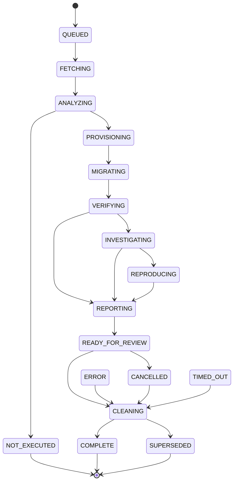

# dataproof-control

The control-plane store: run records, their append-only transition log and the durable job queue, all in PostgreSQL. It implements the run state machine and the supervisor's queue discipline from [ARCHITECTURE](../../docs/ARCHITECTURE.md#run-state-machine). There is no Redis or external queue, and no model has transition authority (ADR-0002).

## Run state machine

Every working state, from `QUEUED` to `REPORTING`, may also go to `ERROR`, `CANCELLED` or `TIMED_OUT` (omitted from the diagram). The table lives in `lifecycle.TRANSITIONS`, and migration 0001 stores the same table in the database. The transition log has a foreign key to it, so even a write that bypasses this package cannot record an illegal transition, and the log rejects `UPDATE` and `DELETE`.

- **No binding-review state.** A run never waits for a human; see `NotRunReason.AWAITING_BINDING_REVIEW` in the contracts package.
- **Interruptions always clean up.** `ERROR`, `CANCELLED` and `TIMED_OUT` lead only to `CLEANING`. The interruption, and any `error_code`, stays in the run record and its log; cleanup never rewrites outcomes.
- **`NOT_EXECUTED`** is decided in `ANALYZING`, before anything is provisioned, so it needs no cleanup.
- **Supersession.** A new webhook or manual run for a pull request supersedes every open run of that pull request bound to a different head SHA. A working or in-review superseded run is cancelled at once. All of them are cleaned up and end `SUPERSEDED`, never `COMPLETE`. Runs that a decision derives from an earlier run (binding approval, correction replay) supersede nothing. Run creation is serialized per pull request, so concurrent webhooks leave exactly one open run.

## Queue, leases and fencing

| Mechanism | Behaviour |
| --- | --- |
| Idempotent creation | One run per input digest (repository, pull request, base and head SHA, config, dataset and engine version). A duplicate request, even a concurrent one, gets the existing run back. |
| Claim | `FOR UPDATE SKIP LOCKED` on the job table. A claim increments the job's **fencing token** and attempt counter and leases the job for a fixed duration. |
| Heartbeat | Extends a live lease. An expired or revoked lease cannot be revived. |
| Fenced writes | Every worker write re-checks owner, token and expiry in the same transaction and raises `LeaseLostError` on mismatch. A transition and its `effects` (for example, results that the stage recorded) commit together or not at all. |
| Revocation | Cancellation, timeout and supersession are made by trusted callers without a lease. They transition the run and increment the token, which fences out the current holder. |
| Retry budget | Attempts are counted per stage, at claim time, so a crashed worker's attempt counts. A failed attempt releases the job with capped exponential backoff. When the budget is spent, a working run goes to `ERROR: RETRY_BUDGET_EXHAUSTED`, and cleanup that never succeeds ends the run with its cleanup recorded as `FAILED`; resources left behind remain for the expiry reconciler. |
| Review TTL | A run in `READY_FOR_REVIEW` is parked until its review TTL expires, then cleaned up. |
| Deadline | Every run has a deadline. `expire_overdue()` times out working runs past it. |

All times come from the database clock, so workers' clocks cannot disagree about leases. Rows are locked in the order `runs`, then `run_jobs`; a claim locks only a job and skips locked rows.

## Correction replay

`RunStore.start_correction_replay(original, head_sha=..., config_digest=..., actor=...)` evaluates a developer-supplied correction commit as a **new** run:

- Its trigger is `CORRECTION_REPLAY`, its `parent_run_id` is the original run, and the actor is recorded on its first transition.
- It keeps the original's repository, pull request, base SHA, dataset and engine version. It is pinned to the correction's own head SHA and config digest, because binding approvals are bound to a head SHA.
- A correction of the commit it corrects is refused, and requesting the same correction twice returns the same run.
- The original run, its transitions and its results are never changed, and the correction supersedes nothing.

## Configurations and binding decisions

Migration 0007 adds two write-once tables:

- `project_configs` holds every project configuration under its digest, the one `RunInputs.config_digest` pins. `save_config` is idempotent, and a different configuration under a stored digest is refused (`ConfigConflictError`). The control plane does not interpret a configuration; the runner validates it again and checks its digest before running anything under it.
- `human_decisions` holds `HumanDecision` documents.

`RunStore.decide_binding(decision, configure=...)` records `APPROVE_BINDING` or `REJECT_BINDING` (ADR-0005):

- The decision is bound to the head SHA of the run decided on and to the binding's digest. A head that the pull request has moved past is refused (`StaleHeadError`). The current head is the one of the pull request's latest webhook or manual run, or of a correction replay requested after it.
- The first decision on a binding at a head stands. Repeating it returns it, with the run it started; contradicting it is refused (`DecisionConflictError`).
- An approval starts a `BINDING_APPROVAL` run, with the run decided on as its parent, under the configuration that `configure` builds from every approval and rejection at that head. The configuration, the run and the decision are written in one transaction under the pull request's lock, so concurrent approvals at one head each see the ones before them.
- The run decided on is never resumed or changed, and the new run supersedes nothing.

Authorization and the approver rule belong to the caller, the reviewer API (work package 9). The store records what an authorized reviewer decided.

## GitHub intake records

Migration 0008 adds two write-once tables for [webhook intake](../../services/api/README.md), read and written through `GitHubRecords`:

- `github_deliveries`: every delivery whose signature verified, and what intake did with it.
- `github_pull_request_heads`: each head's author, head repository and installation, as GitHub reported them.

`RunStore.close_pull_request` cancels every working or reviewable run of a closed pull request, under the pull request's lock.

Migration 0010 adds the reproduction queue (`ReproductionQueue`). It has two tables:

- `reproduction_requests`: write-once, one request per check of a run; asking again returns the existing request.
- `reproduction_jobs`: the leased queue state, claimed with `FOR UPDATE SKIP LOCKED`.

A crashed worker's job is claimed again when its lease expires. A job ends with the `Reproduction` it recorded, or with the reason it failed once its attempts are spent. A worker whose lease was lost cannot end the job.

Migration 0009 adds the check-run outbox: `github_check_runs` (the check run that reports each run, on its head commit) and `github_check_publications` (each status published to it, recorded after GitHub accepted it). Both are write-once.

## Run results

Migration 0002 adds write-once tables for a run's results: `run_sources` (staged archives and their digests), `run_steps` (each step's exit code, timeout, duration and redacted output), `run_checks` (`CheckResult` documents with any binding analysis), `run_evidence` (query and step evidence) and `run_reports` (verdict, GitHub conclusion and coverage). Workers write them with the `record_*` functions in `results.py` inside a transition's `effects`; `RunResults` reads them. Migration 0003 adds `run_snapshots` (each sealed `pg_dump`, the digests of the live and the restored database, and whether they match) and `run_manifests` (the run's `EvidenceManifest`). Migration 0006 adds `run_reproductions`, each a `Reproduction` document. Migration 0005 adds `run_investigations`: each advisory investigation, rule-based or by a model, as an `Investigation` document. Migration 0004 adds `run_previews`: each preview's commit, URL, readiness or failure and measured cost, with the SHA-256 of its token, never the token. Migration 0007 adds `run_checks.binding`, the candidate binding a check was evaluated against or is waiting on. `UPDATE` and `DELETE` are refused on all of them: a correction or a new decision is a new run.

## Schema migrations

`migrate(connection)` applies the numbered SQL files in `src/dataproof_control/migrations/` in order, in one transaction, under an advisory lock. Each applied file's SHA-256 is recorded, and a migration file that changes after it was applied is refused with `MigrationDriftError`: schema changes are always new migrations.

## Tests

`tests/unit/test_lifecycle.py` checks the table's properties: every state reaches a terminal state, interruptions lead only to cleanup, nothing skips a stage or goes back. `tests/integration/test_run_store.py`, `tests/integration/test_decisions.py` and `tests/integration/test_worker.py` run against PostgreSQL. They cover:

- two workers racing for one job, and many workers claiming each job exactly once;
- a stale worker fenced out after its lease expired;
- concurrent duplicate creation, and concurrent heads on one pull request;
- cancellation in the middle of a stage, timeouts and supersession during review;
- retries in place, retry-budget exhaustion and failed cleanup;
- heartbeats keeping a slow stage alive;
- the database rejecting illegal or rewritten transitions;
- binding decisions: stale heads, repeated and contradicting decisions, and concurrent approvals at one head.
