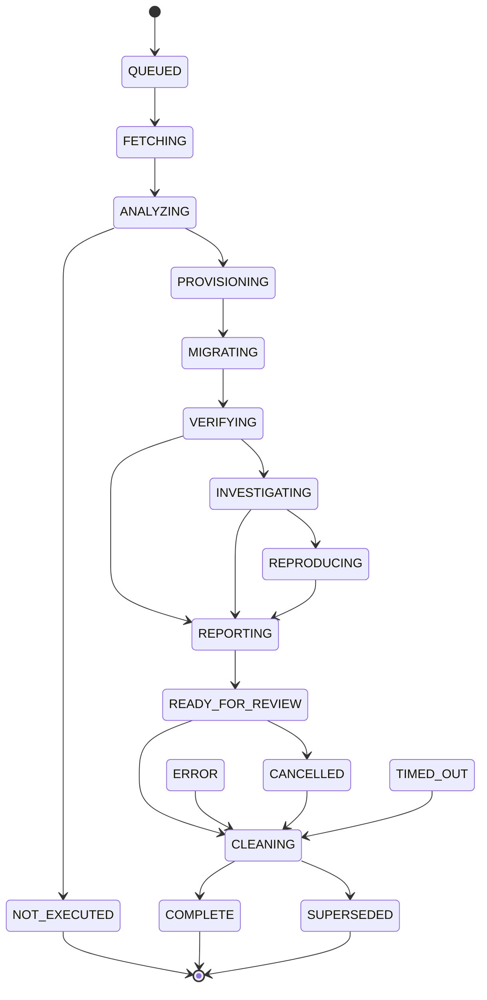

# dataproof-control

The control-plane store: run records, their append-only transition log and the durable job queue, all in PostgreSQL. It implements the run state machine and the supervisor's queue discipline from [ARCHITECTURE](../../docs/ARCHITECTURE.md#run-state-machine). There is no Redis or external queue, and no model has transition authority (ADR-0002).

## Run state machine

Every working state, from `QUEUED` to `REPORTING`, may also go to `ERROR`, `CANCELLED` or `TIMED_OUT` (omitted from the diagram). The table lives in `lifecycle.TRANSITIONS`, and migration 0001 stores the same table in the database. The transition log has a foreign key to it, so even a write that bypasses this package cannot record an illegal transition, and the log rejects `UPDATE` and `DELETE`.

- **No binding-review state.** A run never waits for a human; see `NotRunReason.AWAITING_BINDING_REVIEW` in the contracts package.
- **Interruptions always clean up.** `ERROR`, `CANCELLED` and `TIMED_OUT` lead only to `CLEANING`. The interruption, and any `error_code`, stays in the run record and its log; cleanup never rewrites outcomes.
- **`NOT_EXECUTED`** is decided in `ANALYZING`, before anything is provisioned, so it needs no cleanup.
- **Supersession.** A new webhook or manual run for a pull request supersedes every open run of that pull request bound to a different head SHA. A working or in-review superseded run is cancelled at once. All of them are cleaned up and end `SUPERSEDED`, never `COMPLETE`. Runs that a decision derives from an earlier run (binding approval, correction replay) supersede nothing. Run creation is serialized per pull request, so concurrent webhooks leave exactly one open run.

## Queue, leases and fencing

| Mechanism | Behaviour |
| --- | --- |
| Idempotent creation | One run per input digest (repository, pull request, base and head SHA, config, dataset and engine version). A duplicate request, even a concurrent one, gets the existing run back. |
| Claim | `FOR UPDATE SKIP LOCKED` on the job table. A claim increments the job's **fencing token** and attempt counter and leases the job for a fixed duration. |
| Heartbeat | Extends a live lease. An expired or revoked lease cannot be revived. |
| Fenced writes | Every worker write re-checks owner, token and expiry in the same transaction and raises `LeaseLostError` on mismatch. A transition and its `effects` (for example, results that the stage recorded) commit together or not at all. |
| Revocation | Cancellation, timeout and supersession are made by trusted callers without a lease. They transition the run and increment the token, which fences out the current holder. |
| Retry budget | Attempts are counted per stage, at claim time, so a crashed worker's attempt counts. A failed attempt releases the job with capped exponential backoff. When the budget is spent, a working run goes to `ERROR: RETRY_BUDGET_EXHAUSTED`, and cleanup that never succeeds ends the run with its cleanup recorded as `FAILED`; resources left behind remain for the expiry reconciler. |
| Review TTL | A run in `READY_FOR_REVIEW` is parked until its review TTL expires, then cleaned up. |
| Deadline | Every run has a deadline. `expire_overdue()` times out working runs past it. |

All times come from the database clock, so workers' clocks cannot disagree about leases. Rows are locked in the order `runs`, then `run_jobs`; a claim locks only a job and skips locked rows.

## Schema migrations

`migrate(connection)` applies the numbered SQL files in `src/dataproof_control/migrations/` in order, in one transaction, under an advisory lock. Each applied file's SHA-256 is recorded, and a migration file that changes after it was applied is refused with `MigrationDriftError`: schema changes are always new migrations.

## Tests

`tests/unit/test_lifecycle.py` checks the table's properties: every state reaches a terminal state, interruptions lead only to cleanup, nothing skips a stage or goes back. `tests/integration/test_run_store.py` and `tests/integration/test_worker.py` run against PostgreSQL. They cover:

- two workers racing for one job, and many workers claiming each job exactly once;
- a stale worker fenced out after its lease expired;
- concurrent duplicate creation, and concurrent heads on one pull request;
- cancellation in the middle of a stage, timeouts and supersession during review;
- retries in place, retry-budget exhaustion and failed cleanup;
- heartbeats keeping a slow stage alive;
- the database rejecting illegal or rewritten transitions.
