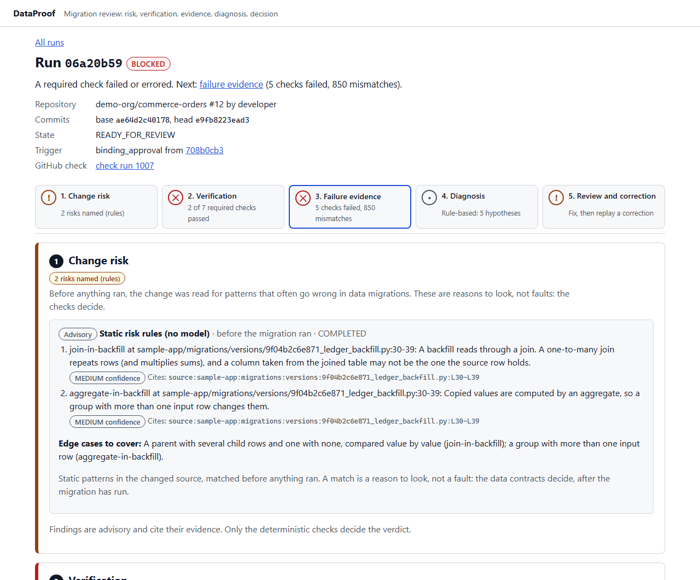
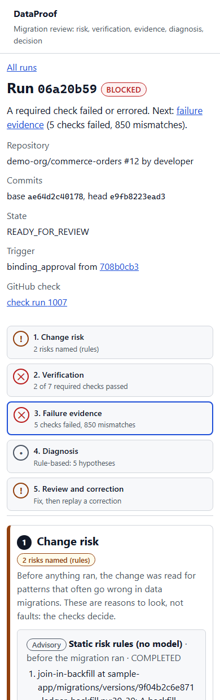
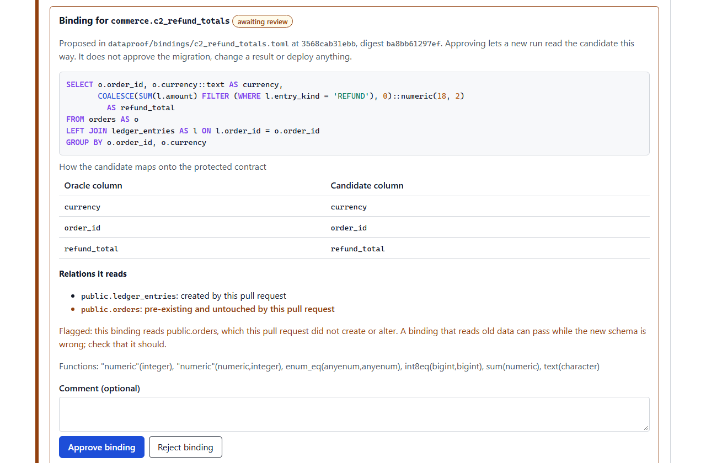

# DataProof dashboard

The reviewer's view of DataProof (ARCHITECTURE, review UI; work package 9, #47). It is a Next.js app that talks only to the [control plane API](../api/README.md).

## Pages

- **Runs** (`/`): the runs of every registered repository the signed-in reviewer can read on GitHub, newest first. Each row shows the repository, pull request, head commit, trigger, state and verdict.
- **Run** (`/runs/{id}`) reads as the review it supports, in five steps. A sticky bar lists them with a status in words, and marks the step that needs the reviewer next:

  | Step | What it shows |
  | --- | --- |
  | 1. Change risk | The Change Analyst's findings from before anything ran: the static risk rules and, if configured, the AI analyst. Each risk cites the lines it rests on and names an edge case. Labelled **Advisory**: a reason to look, not a fault |
  | 2. Verification | The coverage table (requiredness, outcome, reason, mismatch count), linked to each check's evidence. Buttons open the reference and candidate previews through the [signed gateway](../api/README.md#signed-preview-gateway), each on its own host, in a new tab with `noopener,noreferrer` |
  | 3. Failure evidence | Checks ordered failed, errored, not run, then passed (folded away). For each: the first mismatches (key, column, reference and candidate values, SQL `NULL` and absent told apart), the evidence it cites, and **Reproduce on a small subset** for failed data checks. Below, reproductions and pending or failed requests |
  | 4. Diagnosis | The Failure Investigator's findings, labelled **Advisory**: hypotheses, confidence, suggested action and caveat. A citation of check evidence links to that check. A citation of the investigation's own tool call links to that call, whose tool, arguments, SQL and outcome are listed under "What it read". An answer that was rejected is shown as **Not shown**, with the reason, never as a finding |
  | 5. Review and correction | **The binding inspector** for every check awaiting binding review: the binding's SQL, highlighted but rendered as text, its API route, its column mapping, and the relations it reads with their provenance. Relations the pull request did not create or alter are flagged (ADR-0005), and approving does not approve the migration or change a result. **Approve** and **Reject** take an optional comment. Then every recorded decision, the correction-replay form (a full commit SHA) and cancellation |

  Above the steps are the facts: repository, pull request and author, commits (and fork), state, error or not-executed reason, supersession, trigger and parent run, and the GitHub check run, or the newer run that reports on the commit instead. The verdict is explained in one sentence, with the next step. The timeline of every transition is folded at the end.

Captured on real runs of the [local rehearsal](../../docs/DEMO.md#local-rehearsal) by `rehearse.py --screenshots`. GitHub is simulated there; the runs, migrations, previews and contracts are real:

| A blocked run, on a desktop | On a phone |
| --- | --- |
|  |  |



## Accessibility and layout

- **Landmarks:** a skip link to the content. Each step is a section labelled by its heading, and the step bar is a `nav` whose current step carries `aria-current="step"`.
- **Status is never colour alone:** every outcome, verdict and step status is a word in a pill. The colour and a mark (✓, !, ✕) only reinforce it, and the step bar adds the tone in visually hidden text ("needs attention").
- **Tables:** column headers have `scope`, and captions say what each table holds. On narrow screens tables scroll sideways in a focusable region instead of squeezing.
- **Keyboard and focus:** everything is a link, button or form field, with a visible focus ring.
- **Layout:** light and dark colour schemes follow the system. The layout reflows to one column on a phone, and long SHAs and IDs wrap.
- **Status messages:** they appear in one `role="status"` notice fixed in view, so the result of an approval or a replay is seen wherever the reviewer is on the page.

## Security

- The dashboard and the API share one origin. Next.js forwards `/api` and `/auth` to `DATAPROOF_API_ORIGIN` (default `http://127.0.0.1:8000`), which is fixed when the app is built; a production reverse proxy may route them directly instead. The session cookie never leaves that origin.
- Every write sends the session's CSRF token; the browser adds the `Origin` the API checks.
- Text from a pull request (binding SQL, routes, paths, check IDs) is rendered only as React text, never as HTML. SQL highlighting splits the text into tokens inside spans; together they are exactly the original. A test renders SQL containing markup and checks that no element is created.
- Pages are served with a restrictive Content Security Policy (`default-src 'self'`, `object-src 'none'`, `frame-ancestors 'none'`), `X-Frame-Options: DENY`, `nosniff` and `Referrer-Policy: no-referrer`.
- Previews run pull-request code, so they never render inside the dashboard. They open on their own hosts, through the gateway.

## Commands

```bash
pnpm --filter @dataproof/dashboard dev        # needs the API at DATAPROOF_API_ORIGIN
pnpm --filter @dataproof/dashboard typecheck  # next typegen, then tsc
pnpm --filter @dataproof/dashboard test       # vitest (jsdom)
pnpm --filter @dataproof/dashboard build
```

The dashboard stays on TypeScript 5.9 because Next.js type-checks through the TypeScript compiler API, which the native TypeScript 7 does not provide.

## Tests

`test/` runs in CI's `typescript` job, which also builds the app. Fixtures come from the contract package's validated examples where they exist.

- **API client:** writes carry the CSRF token with same-origin credentials, refusals become errors that carry the server's reason, and run IDs are encoded so they cannot change the route.
- **Binding inspector:** hostile SQL is shown as text; relations the pull request did not create or alter are flagged; the reviewer's decision is sent with their comment; a refusal is shown.
- **Views:** a failed check's mismatch row reads `1002 amount 49.99 99.98`; findings are labelled advisory and link their citations; a reproduction shows its outcome; the runs list links to each run and shows its verdict.
- **Journey** (`test/journey.test.tsx`):
  - a blocked run reads as risk, failed verification, evidence, diagnosis, then a correction, and an incomplete one points at its bindings;
  - the step bar says each status in words and marks the next step for assistive technology;
  - highlighted SQL is exactly the original text;
  - a diagnosis links its citations to the check evidence and to the tool call it made;
  - a change analysis says what produced it and when;
  - failed checks come first and passes fold away;
  - every binding awaiting review gets its own inspector.

**Browser end to end** (`tests/e2e/test_review_in_browser.py`, CI's `e2e` job, or locally with `DATAPROOF_E2E=1`):

1. The stack is the API composed from a deployment file, this dashboard built and served by Next.js, PostgreSQL, and a fake GitHub over HTTP.
2. A signed webhook creates a run, and its check waiting on binding review is recorded as `VERIFYING` records it.
3. In Chromium, the reviewer signs in through the fake GitHub, opens the run from the list, sees the binding's SQL and the flagged `public.orders`, writes a comment and approves.
4. The page reports the new run, and the decision appears in the list.
5. The control database then holds the decision (actor, author, comment, binding digest) and exactly one `binding_approval` child run.
